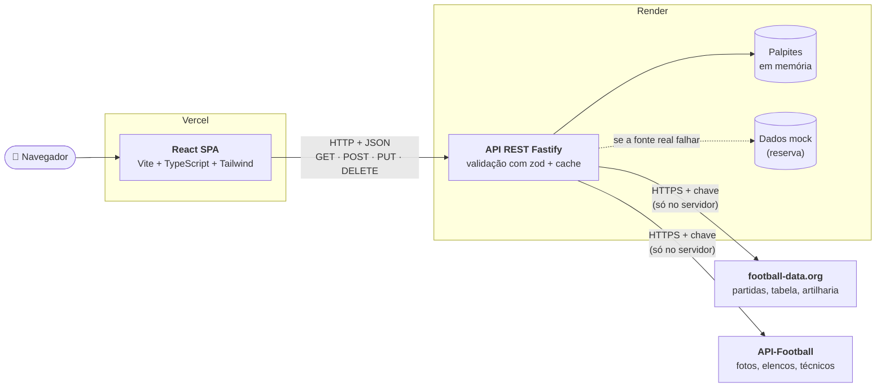
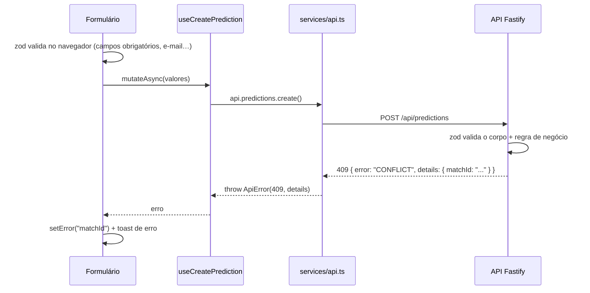

# ⚽ FootStats

Plataforma web de estatísticas de futebol com **dados reais de 10 competições** (Brasileirão,
Premier League, La Liga, Serie A, Bundesliga, Ligue 1, Eredivisie, Primeira Liga,
Championship e Champions League): partidas ao vivo e resultados, classificação ordenável,
artilharia, página de cada time com elenco e um sistema de **palpites** com CRUD completo.

Projeto da disciplina **Programação para Interface de Usuário**, UNIJUÍ, 2026.

| | Link |
|---|---|
| 🌐 **Aplicação em produção** | **https://footstats-beige.vercel.app** |
| 🔌 API em produção | https://footstats-api.onrender.com/health |

> A API usa o plano gratuito do Render e entra em repouso depois de 15 minutos sem uso.
> O primeiro acesso seguinte pode levar até cerca de 1 minuto. Se a tela de erro aparecer,
> clique em "Tentar novamente".

---

## Funcionalidades

- **Partidas**: grid de jogos ao vivo, próximos e encerrados, com escudos, **busca por time** e
  **filtro por status**. Os filtros ficam na URL (`/?status=live&q=gremio`).
- **Classificação**: tabela com os 20 times, **ordenação por qualquer coluna**, destaques
  (líder, melhor ataque e melhor defesa), **artilharia do campeonato** e scroll horizontal no
  celular.
- **Time**: estatísticas da temporada, últimos 5 jogos, técnico com foto, artilheiros do
  time e elenco com fotos, número da camisa e **filtro por posição**.
- **Palpites**: **formulário com 6 campos**, validação e mensagens de erro por campo, além
  de **editar** e **excluir** (com **modal** de confirmação).
- **Modo demonstração** (no rodapé): faz a API responder com erro (500, 503 ou 404) ou com
  atraso, para mostrar as telas de carregando e de erro.

- **Ligas**: seletor no topo do site e uma página com as 10 competições. A liga escolhida
  fica lembrada e vai na URL (`?liga=PL`), para dar para compartilhar o link.

### Requisitos da disciplina

| # | Requisito | Onde está |
|---|---|---|
| 1 | 3+ telas responsivas | Partidas, Classificação, Time, Palpites, Ligas, 404 e Galeria de componentes ([`pages/`](apps/web/src/pages)) |
| 2 | 2+ componentes reutilizáveis | 20+ em [`components/`](apps/web/src/components): `Button`, `Card`, `Badge`, `MatchCard`, `TeamCard`, `PlayerCard`, `LeagueTable`, `Modal`, `Input`, `Select`, `Textarea`, `FilterPills`… A rota `/componentes` mostra todos. |
| 3 | 3+ interações | Seleção de liga, busca, filtro de status, ordenação da tabela, filtro do elenco, "ver todos os artilheiros", modal, menu mobile, editar e excluir |
| 4 | Formulário com 5+ campos e validação | [`PredictionForm.tsx`](apps/web/src/components/predictions/PredictionForm.tsx): 6 campos, react-hook-form + zod e erros visíveis abaixo de cada campo |
| 5 | API REST: GET + 2 outros métodos | `GET`, `POST`, `PUT` e `DELETE` (ver [endpoints](#endpoints)) |
| 6 | Tratamento de respostas e erros | Skeleton, erro com "tentar novamente", lista vazia, toasts e erros 400/409 do backend exibidos no campo certo ([`services/api.ts`](apps/web/src/services/api.ts)) |
| 7 | WCAG AA e Lighthouse > 90 | **Acessibilidade 100** em todas as telas (ver [Acessibilidade](#acessibilidade)) |
| 8 | Repositório público com commits dos 3 integrantes | Ver [Integrantes](#integrantes) |
| 9 | Publicado em produção | Vercel (front) + Render (API) |

---

## Arquitetura



### Comunicação front ↔ back

Toda requisição percorre as mesmas camadas. Cada camada tem uma responsabilidade só:

```
Página ──► Hook (TanStack Query) ──► services/api.ts ──► fetch ──► Fastify ──► módulo ──► fonte de dados
  ▲                                        │
  └──── dados ou ApiError (mensagem amigável) ◄──── JSON { data } ou { error, message, details }
```

| Camada | Arquivo | Responsabilidade |
|---|---|---|
| Página | [`pages/*.tsx`](apps/web/src/pages) | Escolhe o que mostrar: skeleton, erro, lista vazia ou conteúdo |
| Hooks | [`hooks/useApi.ts`](apps/web/src/hooks/useApi.ts) | `useQuery` para os GETs (com cache) e `useMutation` para POST, PUT e DELETE, invalidando o cache depois de cada mutação |
| Serviço | [`services/api.ts`](apps/web/src/services/api.ts) | Único lugar que chama `fetch`. Lê a URL de `VITE_API_URL`, aplica timeout de 15 s e converte qualquer falha (resposta de erro, sem conexão, timeout) em `ApiError` |
| Rotas da API | [`modules/*/*.routes.ts`](apps/api/src/modules) | Valida query, parâmetros e corpo com zod e devolve o status HTTP correto |
| Serviços da API | [`modules/*/*.service.ts`](apps/api/src/modules) | Regras de negócio: partida já iniciada, palpite duplicado… |
| Fonte de dados | [`sources/`](apps/api/src/sources) | Interface `DataSource` com duas implementações, football-data.org (complementada pela API-Football, com cache) e mock. Trocar a fonte não muda as rotas nem o front |
| Tratamento de erros | [`plugins/error-handler.ts`](apps/api/src/plugins/error-handler.ts) | Toda falha sai no mesmo formato `{ error, message, details? }` |

Exemplo do fluxo ao enviar um palpite repetido:



### Fonte dos dados

Os dados vêm de duas APIs gratuitas, cada uma no que faz melhor:

| API | O que fornece | Limite gratuito |
|---|---|---|
| **[football-data.org](https://www.football-data.org)** | Partidas, classificação, artilharia e elencos das 10 competições | 10 req/min (somando todas as ligas) |
| **[API-Football](https://www.api-football.com)** | **Fotos** dos jogadores, número da camisa e **técnico com foto** (9 ligas: todas menos a Champions) | 100 req/dia |

O plano gratuito da API-Football bloqueia dados por temporada (só libera de 2022 a 2024),
mas os endpoints de elenco e de técnico não pedem temporada, e por isso funcionam.

Cada time tem um id em cada API, e a ligação entre eles fica em
[`data/team-links.ts`](apps/api/src/data/team-links.ts). A do Brasileirão foi conferida à
mão. A dos outros 156 times é gerada pelo script
[`scripts/link-teams.mjs`](apps/api/scripts/link-teams.mjs) (`pnpm --filter @footstats/api
link-teams`), que compara nome, sigla e estádio. Para os times promovidos e rebaixados, ele
usa as listas de 2024 da 1ª, da 2ª e da 3ª divisão de cada país. Os times da Champions que
não jogam uma das 8 ligas não têm fotos.

As chaves ficam **só no servidor**, nas variáveis `FOOTBALL_DATA_TOKEN` e
`API_FOOTBALL_KEY`. Elas nunca vão para o front, porque tudo que está no JavaScript do
navegador é público.

- **Cache:** a API guarda as partidas por 1 minuto, a classificação por 5 minutos, a
  artilharia por 10 minutos, os times por 12 horas, e os elencos e técnicos da API-Football
  por 24 horas. Depois de um erro da API-Football (por exemplo, limite excedido), ela faz
  uma pausa de 1 minuto antes de tentar de novo. Assim, faz no
  máximo cerca de 1 requisição por minuto, não importa quantas pessoas estejam usando o site.
  Se uma atualização falhar, o último dado bom continua sendo servido.
- **Conversão:** as respostas da football-data.org são convertidas para o contrato da nossa
  API ([`sources/football-data.ts`](apps/api/src/sources/football-data.ts)). A forma dos
  últimos 5 jogos é calculada a partir das partidas. Gols e cartões por jogador não existem
  de graça para a temporada atual, então a artilharia é exibida em tabela própria.
- **Técnicos:** as duas APIs erram técnicos de times diferentes. A regra é:
  1. vale a correção manual em [`data/coach-overrides.ts`](apps/api/src/data/coach-overrides.ts),
     que é conferida com a imprensa e registra a fonte;
  2. senão, vale o técnico da football-data.org;
  3. a foto vem da API-Football **só quando o nome bate**, então nunca aparece a foto de
     outra pessoa.
- **Várias ligas:** todas as rotas aceitam `?competition=` (padrão: `BSA`), e o cache é
  separado por liga.
- **Cota de fotos:** cada página de time ainda não visitada no dia gasta 2 requisições da
  API-Football (elenco e técnico), e o resultado fica em cache por 24 h. Com 100 por dia,
  dá para abrir uns 50 times diferentes por dia. Depois disso, as páginas continuam
  funcionando, só que sem fotos.
- **Reserva:** se a football-data.org falhar (fora do ar, limite excedido, chave inválida), a
  API passa a servir os **dados mock** do Brasileirão sozinha, e o rodapé do site avisa. Nas
  outras ligas não há mock: a API responde **503** com uma mensagem amigável, e a tela mostra
  "Tentar novamente". O `GET /health` informa a fonte ativa.
- **Mock** ([`sources/mock.ts`](apps/api/src/sources/mock.ts)): uma temporada simulada de
  20 times, com rodadas "jogadas" por um gerador aleatório de semente fixa. A classificação
  sempre fecha (jogos = V + E + D, pontos = 3V + E). É usado nos testes, como reserva, e
  quando não há token configurado.

Os **palpites** ficam em memória na própria API e voltam ao estado inicial quando ela reinicia.

---

## Endpoints

URL base: `http://localhost:3000` (local) ou a URL do Render (produção).

| Método | Rota | Descrição | Respostas |
|---|---|---|---|
| `GET` | `/health` | Status da API e fonte de dados ativa (`dataSource`) | 200 |
| `GET` | `/api/competitions` | Ligas disponíveis (código, nome, país, emblema, temporada) | 200 |
| `GET` | `/api/matches` | Partidas em destaque da liga. Query: `competition` (ex.: `PL`), `status` (`live`, `finished` ou `scheduled`) e `search` (nome ou sigla do time) | 200, 400, 404, 503 |
| `GET` | `/api/matches/:id` | Uma partida | 200, 404 |
| `GET` | `/api/standings` | Classificação. Query: `competition` | 200, 404, 503 |
| `GET` | `/api/teams` | Times da liga. Query: `competition` | 200, 404, 503 |
| `GET` | `/api/teams/:id` | Time de qualquer liga, com classificação, técnico e elenco | 200, 404 |
| `GET` | `/api/scorers` | Artilharia. Query: `competition`, `team` (id do time) e `limit` (1 a 100) | 200, 400, 404, 503 |
| `GET` | `/api/predictions` | Lista palpites (com a partida embutida). Query opcional: `matchId` | 200 |
| `POST` | `/api/predictions` | Cria um palpite | **201**, 400, 409 |
| `PUT` | `/api/predictions/:id` | Substitui um palpite | 200, 400, 404, 409 |
| `DELETE` | `/api/predictions/:id` | Exclui um palpite | **204**, 404 |

**Corpo do POST e do PUT:**

```json
{
  "name": "Ana Souza",
  "email": "ana@example.com",
  "matchId": "555090",
  "homeGoals": 2,
  "awayGoals": 1,
  "comment": "Opcional, até 280 caracteres"
}
```

No `PUT`, o `email` é opcional: se não vier, a API mantém o que já está salvo.

**Privacidade:** as respostas nunca trazem o e-mail completo. No lugar dele vem
`"emailMasked": "an•••@example.com"`. O e-mail completo fica só no servidor, para a regra de
um palpite por e-mail em cada partida.

**Formato de sucesso:** `{ "data": ... }`

**Formato de erro** (o mesmo em todas as rotas):

```json
{
  "error": "VALIDATION_ERROR",
  "message": "Alguns campos estão inválidos. Verifique e tente novamente.",
  "details": { "email": "Informe um e-mail válido.", "homeGoals": "O placar não pode ser negativo." }
}
```

| Código | Quando |
|---|---|
| `VALIDATION_ERROR` (400) | Corpo ou query inválidos, ou palpite em partida que já começou |
| `BAD_REQUEST` (400) | JSON malformado |
| `NOT_FOUND` (404) | Recurso, rota ou liga inexistente |
| `CONFLICT` (409) | O mesmo e-mail já palpitou nessa partida |
| `UPSTREAM_UNAVAILABLE` (503) | A football-data.org falhou numa liga sem reserva (ou o limite de consultas estourou) |
| `INTERNAL_ERROR` (500) | Erro inesperado |

### Simulação de erros e latência

Funciona em qualquer rota, exceto `/health`. É o que o **Modo demonstração** do front usa.

| Query | Header | Efeito |
|---|---|---|
| `?simulateError=true` | `x-simulate-error: true` | Responde 500 |
| `?simulateError=503` | `x-simulate-error: 503` | Responde o status informado (400 a 599) |
| `?delay=2000` | `x-simulate-delay: 2000` | Atrasa a resposta em ms (máx. 10 000) |

Exemplo: `curl "http://localhost:3000/api/standings?simulateError=503&delay=1500"`

---

## Como rodar localmente

**Pré-requisitos:** Node.js 20 ou superior e pnpm (`npm install -g pnpm`).

```bash
git clone https://github.com/NandoCastro09/footstats.git
cd footstats
pnpm install
pnpm dev
```

| Serviço | Endereço |
|---|---|
| Front | http://localhost:5173 |
| API | http://localhost:3000/health |

Sem configurar nada, a API usa os **dados mock**. Para usar os **dados reais**, crie uma chave
gratuita em [football-data.org](https://www.football-data.org/client/register) e, se quiser
fotos, outra em [API-Football](https://dashboard.api-football.com). Coloque as duas em
`apps/api/.env`:

```bash
FOOTBALL_DATA_TOKEN=sua_chave_aqui
API_FOOTBALL_KEY=sua_chave_aqui   # opcional
```

Os outros valores padrão já funcionam localmente. Para alterá-los, copie os exemplos:
[`apps/web/.env.example`](apps/web/.env.example) para `apps/web/.env` (`VITE_API_URL`) e
[`apps/api/.env.example`](apps/api/.env.example) para `apps/api/.env` (`PORT`,
`CORS_ORIGIN`, `DATA_SOURCE`, `FOOTBALL_DATA_TOKEN` e `API_FOOTBALL_KEY`).

### Scripts

| Comando | O que faz |
|---|---|
| `pnpm dev` | Front e API juntos, com recarregamento automático |
| `pnpm build` | Build de produção dos dois apps |
| `pnpm lint` | ESLint (front) e type-check (API) |
| `pnpm --filter @footstats/api link-teams` | Gera de novo a ligação de times entre as APIs (próxima temporada) |
| `pnpm --filter @footstats/api test` | 61 testes da API (Vitest): rotas, conversão das duas APIs, comparação de nomes, cache, pausa e reserva |

### Estrutura

```
footstats/
├── apps/
│   ├── web/                    # Front: React 19 + Vite + TypeScript + Tailwind
│   │   ├── src/
│   │   │   ├── pages/          # Uma página por rota
│   │   │   ├── league/         # Liga selecionada (contexto + URL ?liga= + navegador)
│   │   │   ├── components/     # Componentes reutilizáveis (+ layout/, predictions/, toast/)
│   │   │   ├── hooks/          # useApi (TanStack Query), usePageTitle, useDebouncedValue
│   │   │   ├── services/       # api.ts (fetch centralizado) e modo demonstração
│   │   │   ├── schemas/        # Validação zod do formulário
│   │   │   ├── lib/            # Formatação de datas, helpers
│   │   │   └── types/          # Tipos do domínio (contrato com a API)
│   │   ├── tailwind.config.js  # Tokens do design system
│   │   └── vercel.json         # Fallback do SPA
│   └── api/                    # Back: Fastify 4 + TypeScript + zod
│       └── src/
│           ├── modules/        # competitions, matches, standings, teams, scorers, predictions
│           ├── sources/        # Fontes de dados: football-data.org, API-Football, mock e reserva
│           ├── data/           # Mock, ligação de ids entre as APIs, correções de técnico, palpites iniciais
│           ├── plugins/        # Tratamento de erros e simulação
│           └── *.test.ts       # Testes (Vitest)
├── docs/DEPLOY.md              # Passo a passo do deploy
└── render.yaml                 # Configuração da API no Render
```

---

## Acessibilidade

Medido no build de produção com o Lighthouse 12 e o axe-core 4:

| Tela | Lighthouse Acessibilidade (mobile / desktop) | axe-core (WCAG 2.1/2.2 AA) |
|---|---|---|
| Partidas | 100 / 100 | 0 violações |
| Classificação | 100 / 100 | 0 violações |
| Time | 100 / 100 | 0 violações |
| Palpites (incluindo formulário com erros e modal aberto) | 100 / 100 | 0 violações |
| 404 | 100 / 100 | 0 violações |

O que foi aplicado:

- `lang="pt-BR"`, um `<title>` por página, landmarks (`header`, `nav`, `main`, `footer`), um
  `h1` por página e hierarquia de títulos correta.
- Link "Pular para o conteúdo". Ao trocar de página, o foco vai para o conteúdo novo.
- Todo campo tem `label`. Os erros ficam ligados ao campo por `aria-invalid` e
  `aria-describedby` e são anunciados com `aria-live`. Depois de um envio inválido, o foco
  vai para o primeiro campo com erro.
- Modal com `role="dialog"`, `aria-modal`, foco preso dentro dele, fechamento com Esc e
  devolução do foco ao botão que o abriu.
- Menu mobile com `aria-expanded`. Foco sempre visível. Áreas de toque de pelo menos 44 px.
- Tabela com `<caption>`, `<th scope>`, `aria-sort` e scroll horizontal acessível pelo
  teclado.
- **Contraste AA conferido em todos os pares de cores** (ver os comentários em
  [`tailwind.config.js`](apps/web/tailwind.config.js)). O coral `#D85A30` dá só 3,9:1 com
  branco, então os botões usam o `#BA3A18` (5,7:1).
- **Resultado nunca é indicado só por cor:** vencedor com ícone de troféu e texto, forma
  com as letras V, E e D, lesionado com ícone e texto.

## Design system

| Token | Cor | Uso |
|---|---|---|
| `primary` | `#185FA5` | Navegação, botões principais, headers |
| `success` | `#3B6D11` | Vitórias e resultados positivos |
| `live` / `live-strong` | `#D85A30` / `#BA3A18` | "Ao vivo" e CTAs (o tom forte para texto e fundo de botão) |
| `warning` / `warning-text` | `#BA7517` / `#8A5410` | Avisos e cartão amarelo |
| `danger` | `#A32D2D` | Derrotas e erros de formulário |
| `ink` / `ink-muted` | `#2C2C2A` / `#5F5E5A` | Texto principal e texto secundário |
| `line` / `line-strong` | `#D3D1C7` / `#8A887F` | Bordas de cards e bordas de inputs (3:1) |

Tipografia: **Roboto** para títulos e números e **Inter** para o corpo. Ícones outline do
[lucide](https://lucide.dev). Espaçamento em base 8 px. Raio de 8 px em controles e de 12 px
em cards.

---

## Tecnologias

**Front:** React 19, TypeScript, Vite 5, Tailwind CSS 3, React Router 7, TanStack Query 5,
React Hook Form, Zod e lucide-react.

**Back:** Node.js, Fastify 4, @fastify/cors, Zod, TypeScript e Vitest.

**Dados:** [football-data.org](https://www.football-data.org) (API v4) e
[API-Football](https://www.api-football.com) (API v3), as duas no plano gratuito.

**Infra:** monorepo com pnpm workspaces, Vercel (front) e Render (API).

## Deploy

O passo a passo completo, com os campos de cada painel, está em
**[docs/DEPLOY.md](docs/DEPLOY.md)**.

## Integrantes

| Nome | GitHub | Responsabilidade |
|---|---|---|
| Nando | [@NandoCastro09](https://github.com/NandoCastro09) | Configuração do monorepo, telas do front, formulário de palpites, acessibilidade, README e deploy |
| Eduardo Kroth | [@Kroth09](https://github.com/Kroth09) | Design system e componentes base (Button, Card, Badge, MatchCard, TeamCard, LeagueTable) |
| Rogério | [@Rog3rinS](https://github.com/Rog3rinS) | API REST: integração com as fontes de dados, palpites e tratamento de erros |
